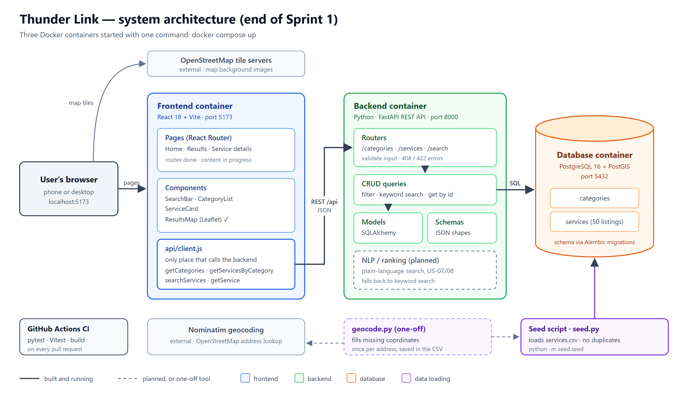
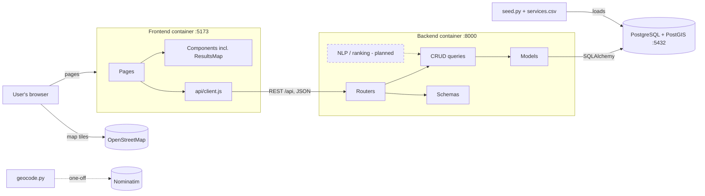
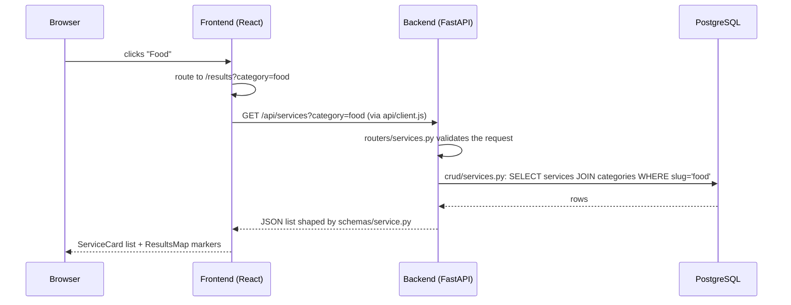

# Architecture (P2.2)

Owner: Azad. This describes the code on `main` at the end of Sprint 1. Anything not built yet is marked **planned**.

## Overview

Thunder Link is a three-tier web application. Each tier runs in its own Docker container, and `docker compose up` starts all three.

The same diagram as text (GitHub renders this):

## Components

| Component | Responsibility | Files | Owner | Status |
|---|---|---|---|---|
| **Pages** | Home (search + categories), Results (list + map), Service details | `frontend/src/pages/` | Kamakshi | Routes exist; page content in progress |
| **Components** | `SearchBar`, `CategoryList`, `ServiceCard`, `ResultsMap` | `frontend/src/components/` | Kamakshi, Dhara (map) | `ResultsMap` done; others in progress |
| **API client** | The only place the frontend calls the backend | `frontend/src/api/client.js` | Azad | Done |
| **Routers** | HTTP endpoints: validate input, return errors (404, 422) | `backend/app/routers/` | Santhosh | Done |
| **Schemas** | The exact JSON shape every endpoint returns | `backend/app/schemas/` | Azad | Done |
| **CRUD** | All database queries (category list, filter, search, get by id) | `backend/app/crud/` | Santhosh | Done |
| **Models** | Database tables (`categories`, `services`) | `backend/app/models/` | Azad | Done |
| **Migrations** | Versioned schema changes; enables PostGIS | `backend/alembic/` | Azad | Done |
| **Seed** | Loads `services.csv` into the database without duplicates | `backend/seed/seed.py` | Azad | Done |
| **Data + geocoding** | 50 checked Thunder Bay services; one-off coordinate lookup | `backend/seed/data/services.csv`, `backend/seed/geocode.py` | Dhara | Done |
| **NLP / ranking** | Plain-language search and ranking (US-07, US-08) | `backend/app/nlp/` | — | **Planned** (Sprint 2) |
| **Database** | PostgreSQL 16 with the PostGIS extension | `db` container | Azad | Done |

## How a request flows

Example: a user picks **Food** on the home page.

Search (`/api/search?q=`) and details (`/api/services/{id}`) follow the same path: router → CRUD query → schema → JSON.

## Data model

| Table | Columns | Rules |
|---|---|---|
| `categories` | `id`, `name`, `slug` | `name` and `slug` are unique. `slug` is used in URLs (`mental-health`) |
| `services` | `id`, `name`, `category_id`, `description`, `address`, `latitude`, `longitude`, `hours`, `phone`, `website`, `eligibility`, `last_updated` | `name` + `address` is unique, so a listing can't be stored twice. `last_updated` is set automatically on insert and update (used later for NFR-07, flagging stale listings) |

Each service belongs to one category. The API contract for these objects is in [`api.md`](api.md).

## How it runs

| Container | Port | What starts |
|---|---|---|
| `db` | 5432 | PostgreSQL 16 + PostGIS 3.4 (`postgis/postgis` image), data kept in a Docker volume |
| `backend` | 8000 | Runs `alembic upgrade head` (creates/updates tables), then the FastAPI app. Interactive docs at `/docs` |
| `frontend` | 5173 | Vite dev server. Requests to `/api/...` are forwarded to the backend, so the frontend never hard-codes the backend address |

Data is loaded once with `docker compose exec backend python -m seed.seed`, and can be re-run safely after editing the CSV.

## Testing and CI

| Layer | Tool | What runs |
|---|---|---|
| Backend | pytest + FastAPI TestClient, in-memory SQLite | Models, every endpoint, seed script, CSV data checks (60 tests) |
| Frontend | Vitest + React Testing Library | App routes, API client, map component (10 tests) |
| CI | GitHub Actions (`.github/workflows/ci.yml`) | Both suites plus the frontend production build on every pull request and every push to `main` |

`main` is protected by a ruleset: changes arrive only through pull requests. Details of the test approach are in [`testing-plan.md`](testing-plan.md).

## Design decisions

| Decision | Why | Requirement |
|---|---|---|
| **Three containers with Docker Compose** | Everyone runs the identical stack with one command, and the same containers can be deployed later | NFR-06 |
| **Layered backend: routers → CRUD → models** | Endpoints stay short and never contain SQL. Queries are tested and reused in one place, and the planned NLP module can call the same search query | NFR-05 |
| **REST API with a written contract (`api.md`)** | Frontend and backend were built in parallel by different people against an agreed shape | — |
| **One API client in the frontend** | Pages never build URLs themselves, so an endpoint change is a one-file change | — |
| **Vite proxy for `/api`** | No hard-coded backend URL and no cross-origin problems in development | — |
| **PostgreSQL + PostGIS** | Distance queries for "near me" (US-06) can run in the database. Sprint 1 stores plain latitude/longitude; a PostGIS geography column is planned for US-06 | FR-06 |
| **CSV as the data source, loaded by an idempotent seed** | Listings are checked by hand and reviewed in pull requests. Re-running the seed updates changed rows and never duplicates them | FR-01, US-01 |
| **Geocoding separate from seeding** | Nominatim allows 1 request per second and asks for no bulk use, so coordinates are looked up once and saved in the CSV | P1 risk: Nominatim limits |
| **Safe keyword search** | Case-insensitive match on name, category and description, with `%` and `_` treated as plain text, so user input can't change the query | FR-03, NFR-03 |
| **Keyword search kept as the fallback** | When plain-language search is added it sits in front of keyword search, so search still works if the NLP part fails | NFR-04 |
| **Backend tests on SQLite** | Fast and need no Docker, so CI stays quick. Trade-off: PostGIS features will need extra tests against PostgreSQL | NFR-05 |
| **Alembic migrations** | Schema changes are versioned in git and applied automatically when the backend starts | NFR-05 |

## Planned changes (Sprint 2 onward)

- **Location and distance (US-06):** add a PostGIS geography column, geocode user-typed addresses with Nominatim (cached), and return distance with results.
- **Plain-language search and ranking (US-07, US-08):** an `nlp` module that turns a sentence into a category and eligibility hints, then ranks results. It falls back to keyword search on failure or timeout (NFR-04).
- **Accounts and admin (US-09 to US-15):** users and roles tables, hashed passwords (bcrypt), and role checks on admin endpoints that return 403 (NFR-03).
