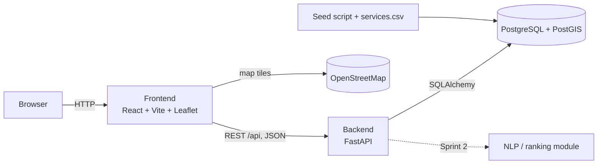

# Architecture (P2.2)

Owner: Azad. This is a first draft; update it to match what we actually built before the P2 report.

## Overview

Thunder Link is a three-tier web application, with each tier in its own Docker container:

## Components

| Component | Responsibility | Location |
|---|---|---|
| Frontend | Pages, search bar, category list, map. Talks to the backend only through `api/client.js`. | `frontend/src/` |
| API layer (routers) | HTTP endpoints, input validation, response shapes | `backend/app/routers/`, `backend/app/schemas/` |
| Data access (crud) | All database queries | `backend/app/crud/` |
| Models | Database tables | `backend/app/models/` |
| NLP / ranking | Turns plain-language requests into categories and ranks results (Sprint 2) | `backend/app/nlp/` |
| Database | Service listings and categories; PostGIS for distance queries | `db` container |
| Seed | Loads checked Thunder Bay listings | `backend/seed/` |

## Design decisions

- **Layered backend (routers → crud → models).** Endpoints don't write SQL themselves, so queries can be tested and reused, and the NLP module can call the same search functions.
- **REST API with a written contract (`docs/api.md`).** Frontend and backend can be built in parallel by different people.
- **PostgreSQL + PostGIS.** Distance queries (US-06) run in the database instead of in Python.
- **Keyword search stays as the fallback.** When NLP is added it sits in front of keyword search, so if it fails the search still works (NFR-04).
- **Docker Compose.** Everyone runs the same setup with one command (NFR-06).
- **Alembic migrations.** Schema changes are versioned in git.

TODO: export the diagram as an image into `docs/diagrams/` for the PDF report.
